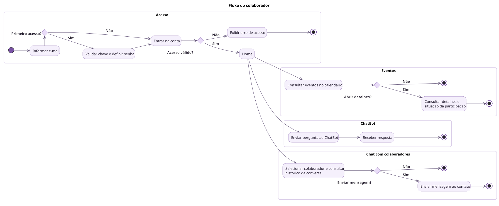

# Diagramas do Astro

Diagramas PlantUML do Astro, na tarefa [SCRUM-558](https://luizacursino.atlassian.net/browse/SCRUM-558).

O repositório mantém somente os três diagramas do ZIP: casos de uso, fluxo do colaborador e fluxo do gestor. O caso de uso mantém a versão simplificada e os papéis ajustados. Os dois fluxos usam as jornadas do ZIP como referência, revisadas para mostrar ações distintas, decisões e o encerramento de cada escolha.

O [relatório de revisão](docs/revisao-contexto.md) registra separadamente a análise dos 21 repositórios da Astro-Inter e as diferenças entre a documentação original e o código consultado.

No caso de uso, `<<include>>` representa a validação da chave como parte obrigatória da criação do workspace. `<<extend>>` representa a ativação da conta como complemento do acesso, apenas no primeiro acesso.

## Navegação

| Diagrama | O que mostra | Fonte editável |
| --- | --- | --- |
| [Casos de uso e papéis](diagrams/rendered/casos_de_uso.svg) | Responsabilidades de Colaborador, Gestor, Gestor do Workspace e ADMIN. | [casos-de-uso.plantuml](diagrams/casos-de-uso.plantuml) |
| [Jornada do colaborador](diagrams/rendered/fluxo_colaborador.svg) | Login, cadastro, calendário e conversas. | [fluxo-colaborador.plantuml](diagrams/fluxo-colaborador.plantuml) |
| [Jornada do gestor](diagrams/rendered/fluxo_gestor.svg) | Acesso ao workspace, configurações, unidades e cadastro de colaboradores. | [fluxo-gestor.plantuml](diagrams/fluxo-gestor.plantuml) |

## Visualização

No VS Code, abra este README e pressione **Ctrl + Shift + V**. Expanda o diagrama desejado. Cada imagem possui um link para abrir em tamanho completo; os arquivos SVG podem ser abertos no navegador e ampliados sem perder nitidez.

<details open>
<summary>Casos de uso e papéis</summary>

Responsabilidades de Colaborador, Gestor, Gestor do Workspace e ADMIN.

[Abrir imagem em tamanho completo](diagrams/rendered/casos_de_uso.svg) · [Editar PlantUML](diagrams/casos-de-uso.plantuml)


</details>

<details>
<summary>Jornada do colaborador</summary>

Login, cadastro, calendário e conversas.

[Abrir imagem em tamanho completo](diagrams/rendered/fluxo_colaborador.svg) · [Editar PlantUML](diagrams/fluxo-colaborador.plantuml)



</details>

<details>
<summary>Jornada do gestor</summary>

Acesso ao workspace, configurações, unidades e cadastro de colaboradores.

[Abrir imagem em tamanho completo](diagrams/rendered/fluxo_gestor.svg) · [Editar PlantUML](diagrams/fluxo-gestor.plantuml)


</details>

## Atualizar as imagens

Os `.plantuml` são as fontes; os SVGs em `diagrams/rendered/` são as imagens versionadas no README. Depois de editar uma fonte ou o estilo compartilhado `diagrams/estilo.iuml`, gere novamente as imagens a partir da raiz do repositório:

```sh
java -jar plantuml.jar -charset UTF-8 -checkonly "diagrams/*.plantuml"
java -jar plantuml.jar -charset UTF-8 -Playout=smetana -tsvg -o rendered "diagrams/*.plantuml"
```

O comando usa Java e PlantUML com Smetana, sem instalação separada de Graphviz. O estilo é local, sem includes remotos. Para manter fontes e imagens coerentes, inclua ambos no mesmo commit.

## Referência dos fluxos

Os fluxos mostram as ações do usuário e seus resultados. Consultar uma informação não exige etapas duplicadas de abrir tela e carregar a mesma informação pela API. Cada opção termina a tarefa escolhida; o ponto final não significa sair da conta. Os caminhos de sim e não também têm continuação ou encerramento explícito.

O sistema não armazena certificados. A participação nos treinamentos aparece nos eventos. As opções do gestor separam configurações, cadastro manual e cadastro por planilha. Criar uma unidade durante o cadastro manual permite continuar o cadastro do colaborador.

O [relatório de revisão](docs/revisao-contexto.md) registra a análise técnica anterior. Os desenhos atuais priorizam uma visão funcional, sem duplicar chamadas de API, persistência ou navegação.
