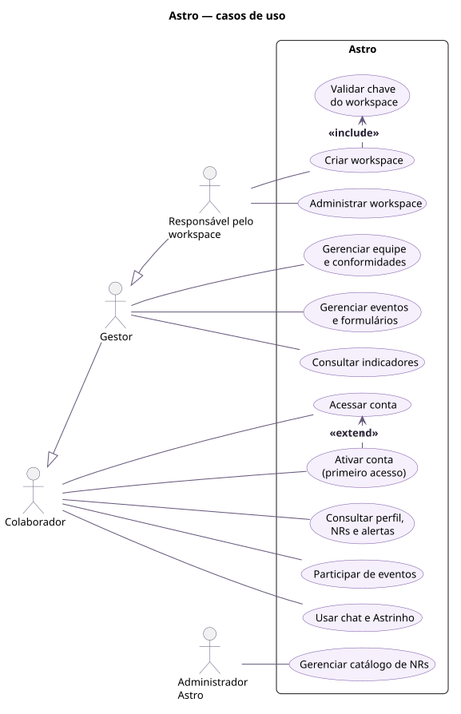
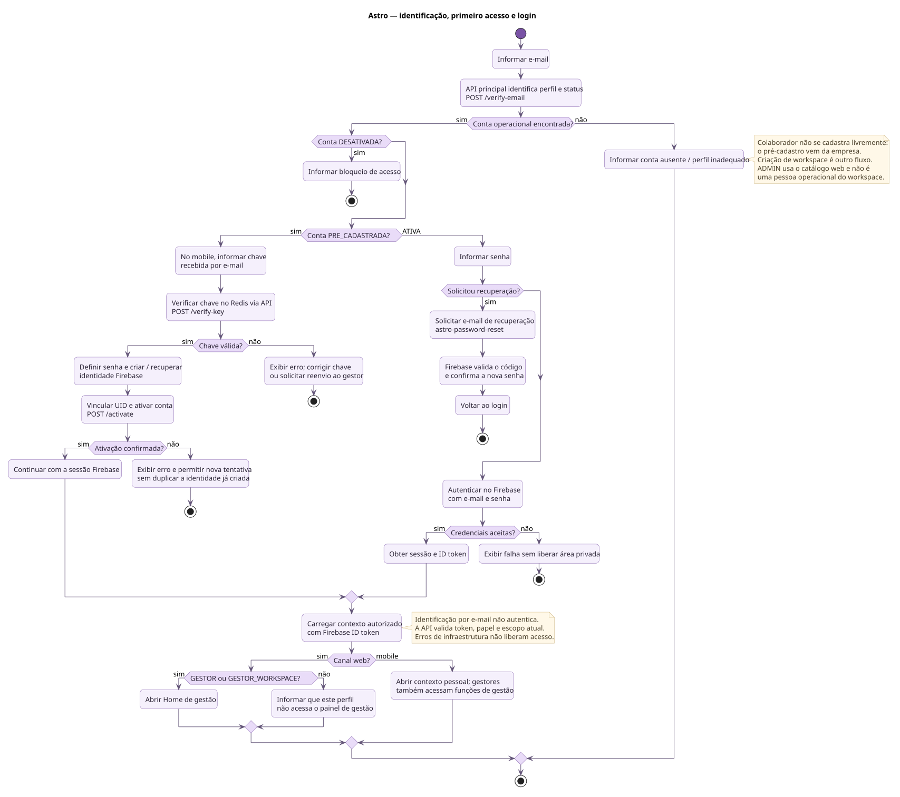
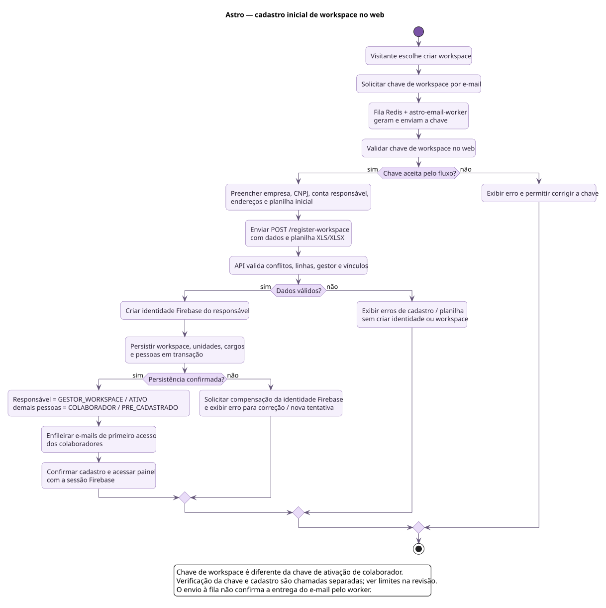
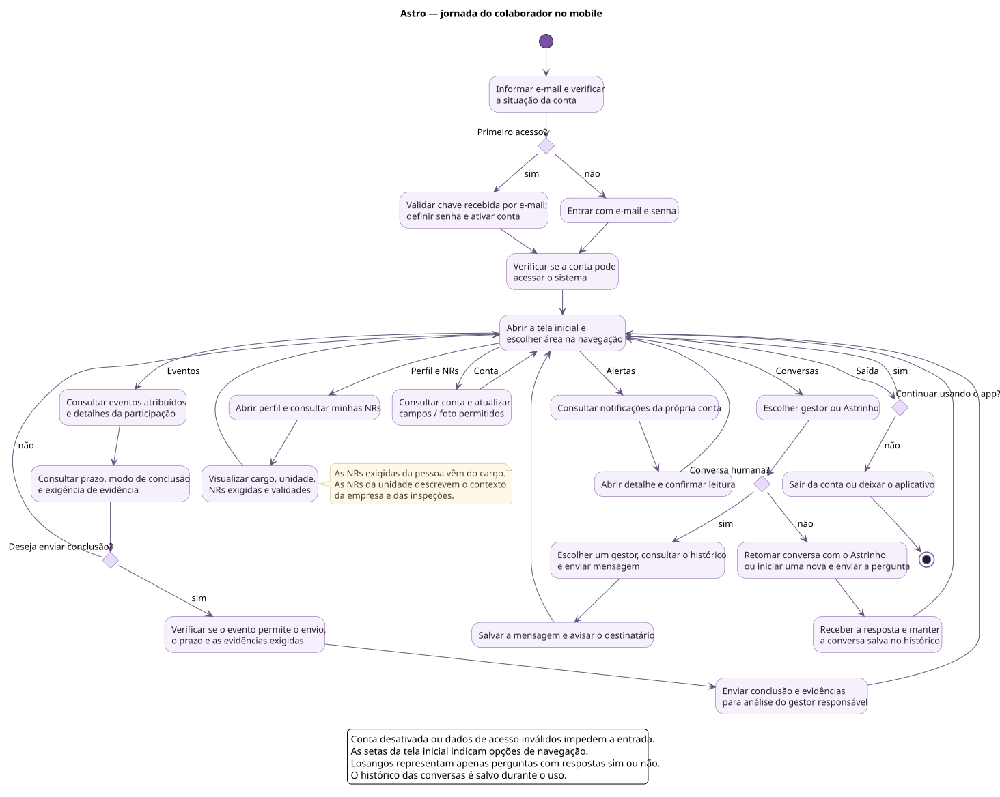
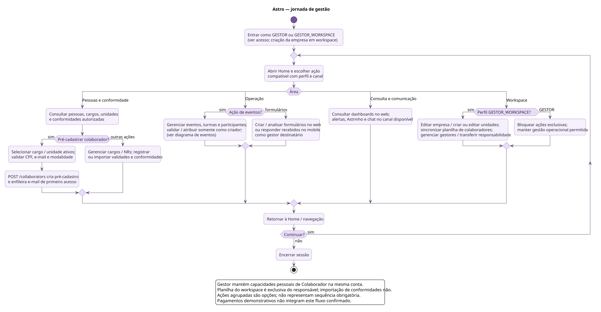
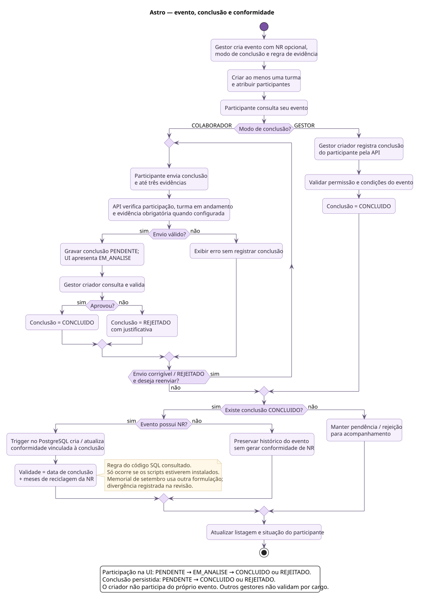
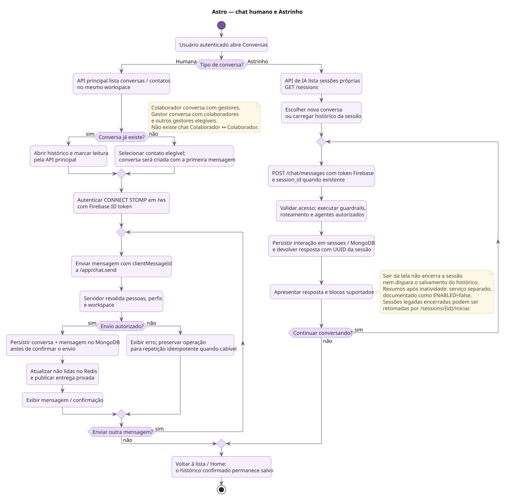
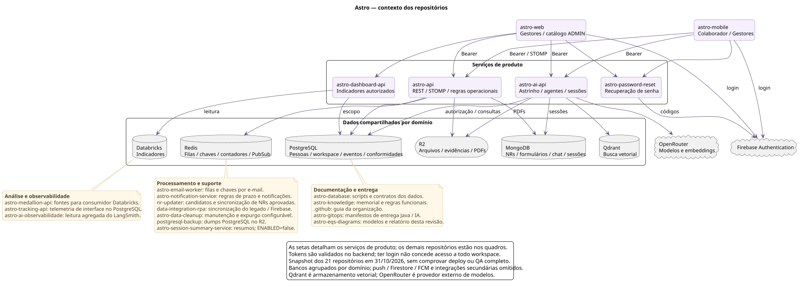

# Diagramas do Astro

Diagramas PlantUML revisados com os repositórios da [Astro-Inter](https://github.com/orgs/Astro-Inter/repositories), na tarefa [SCRUM-558](https://luizacursino.atlassian.net/browse/SCRUM-558).

A revisão de **31/10/2026** substitui a transcrição literal das imagens do ZIP por uma visão baseada no código e nos contratos consultados. Foram inventariados **21 repositórios**, com aprofundamento nos fluxos pertinentes. O [relatório de revisão](docs/revisao-contexto.md) reúne correções, evidências fixadas por commit e divergências entre memorial e implementação.

Os diagramas representam o comportamento descrito no código. Eles não confirmam deploy, ativação de workers ou testes ponta a ponta. A versão que transcreve o ZIP permanece no histórico Git, no commit `d0a4543`.

## Navegação

| Diagrama | O que mostra | Fonte editável |
| --- | --- | --- |
| [Casos de uso e papéis](diagrams/rendered/casos_de_uso.svg) | Responsabilidades de Colaborador, Gestor, Gestor do Workspace e ADMIN. | [casos-de-uso.plantuml](diagrams/casos-de-uso.plantuml) |
| [Acesso e primeiro login](diagrams/rendered/acesso.svg) | Identificação, chave, ativação e autenticação Firebase. | [acesso.plantuml](diagrams/acesso.plantuml) |
| [Criação do workspace](diagrams/rendered/workspace.svg) | Chave de empresa, planilha inicial e conta responsável. | [workspace.plantuml](diagrams/workspace.plantuml) |
| [Jornada do colaborador](diagrams/rendered/fluxo_funcionario.svg) | Eventos, perfil e NRs, alertas, conta e comunicação no mobile. | [fluxo-funcionario.plantuml](diagrams/fluxo-funcionario.plantuml) |
| [Jornada do gestor](diagrams/rendered/fluxo_gestor.svg) | Criação da empresa, operação cotidiana e ações exclusivas do responsável. | [fluxo-gestor.plantuml](diagrams/fluxo-gestor.plantuml) |
| [Eventos e conformidade](diagrams/rendered/eventos.svg) | Turmas, evidências, atribuição, validação e geração de conformidade. | [eventos.plantuml](diagrams/eventos.plantuml) |
| [Chat humano e Astrinho](diagrams/rendered/comunicacao.svg) | Serviços, autorização e salvamento de histórico em cada modalidade. | [comunicacao.plantuml](diagrams/comunicacao.plantuml) |
| [Contexto dos repositórios](diagrams/rendered/arquitetura.svg) | Integrações principais, dados, processos de suporte e entrega. | [arquitetura.plantuml](diagrams/arquitetura.plantuml) |

## Visualização

No VS Code, abra este README e pressione **Ctrl + Shift + V**. Expanda o diagrama desejado. Cada imagem possui um link para abrir em tamanho completo; os arquivos SVG podem ser abertos no navegador e ampliados sem perder nitidez.

<details open>
<summary>Casos de uso e papéis</summary>

Responsabilidades de Colaborador, Gestor, Gestor do Workspace e ADMIN.

[Abrir imagem em tamanho completo](diagrams/rendered/casos_de_uso.svg) · [Editar PlantUML](diagrams/casos-de-uso.plantuml)



</details>

<details>
<summary>Acesso e primeiro login</summary>

Identificação, chave, ativação e autenticação Firebase.

[Abrir imagem em tamanho completo](diagrams/rendered/acesso.svg) · [Editar PlantUML](diagrams/acesso.plantuml)



</details>

<details>
<summary>Criação do workspace</summary>

Chave de empresa, validação da planilha inicial, conta responsável e pré-cadastros.

[Abrir imagem em tamanho completo](diagrams/rendered/workspace.svg) · [Editar PlantUML](diagrams/workspace.plantuml)



</details>

<details>
<summary>Jornada do colaborador</summary>

Eventos, perfil e NRs, alertas, conta e comunicação no mobile.

[Abrir imagem em tamanho completo](diagrams/rendered/fluxo_funcionario.svg) · [Editar PlantUML](diagrams/fluxo-funcionario.plantuml)



</details>

<details>
<summary>Jornada do gestor</summary>

Criação da empresa, operação cotidiana e ações exclusivas do responsável.

[Abrir imagem em tamanho completo](diagrams/rendered/fluxo_gestor.svg) · [Editar PlantUML](diagrams/fluxo-gestor.plantuml)



</details>

<details>
<summary>Eventos e conformidade</summary>

Turmas, evidências, atribuição, validação e geração de conformidade.

[Abrir imagem em tamanho completo](diagrams/rendered/eventos.svg) · [Editar PlantUML](diagrams/eventos.plantuml)



</details>

<details>
<summary>Chat humano e Astrinho</summary>

Serviços, autorização e salvamento de histórico em cada modalidade.

[Abrir imagem em tamanho completo](diagrams/rendered/comunicacao.svg) · [Editar PlantUML](diagrams/comunicacao.plantuml)



</details>

<details>
<summary>Contexto dos repositórios</summary>

Integrações principais, dados, processos de suporte e entrega.

[Abrir imagem em tamanho completo](diagrams/rendered/arquitetura.svg) · [Editar PlantUML](diagrams/arquitetura.plantuml)



</details>

## Atualizar as imagens

Os `.plantuml` são as fontes; os SVGs em `diagrams/rendered/` são as imagens versionadas no README. Depois de editar uma fonte ou o estilo compartilhado `diagrams/estilo.iuml`, gere novamente as imagens a partir da raiz do repositório:

```sh
java -jar plantuml.jar -charset UTF-8 -checkonly "diagrams/*.plantuml"
java -jar plantuml.jar -charset UTF-8 -Playout=smetana -tsvg -o rendered "diagrams/*.plantuml"
```

O comando usa Java e PlantUML com Smetana, sem instalação separada de Graphviz. O estilo é local, sem includes remotos. Para manter fontes e imagens coerentes, inclua ambos no mesmo commit.

## Principais correções

- Separação de Colaborador, Gestor, Gestor do Workspace e ADMIN, com limites por canal.
- Primeiro acesso por chave separado de login Firebase e criação de workspace.
- Ações de navegação como escolhas, com retorno à Home; sem paralelismo artificial.
- Eventos com turmas, evidências e validação pelo gestor criador.
- Certificados tratados como possíveis evidências, sem uma relação obrigatória de consulta para alteração.
- Chat humano e IA com persistência durante a interação; sair da tela não dispara o salvamento.
- Serviços automáticos, dados e integrações apresentados com seus limites documentados.

Consulte as [divergências que exigem decisão do projeto](docs/revisao-contexto.md#divergências-que-exigem-decisão-do-projeto) antes de usar estes diagramas como especificação de novas regras de negócio.
